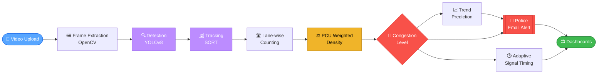

<div align="center">


<a href="https://github.com/adhilaashraf/trafficregulation">
  
</a>

<br/>


<br/>

### 🎓 MCA Final Year Project · MES ENGINEERING COLLEGE

**Real-time vehicle detection, weighted density analysis, adaptive signal control and automated police alerts, all from a traffic video.**

</div>

---

## 📑 Quick Navigation

| 🚦 | 🧠 | 📊 | 🔔 | 👥 |
|:--:|:--:|:--:|:--:|:--:|
| [Problem](#-the-problem-double-counting) | [Pipeline](#-how-the-system-works) | [PCU & Density](#-weighted-density-with-pcu) | [Alerts](#-automated-police-alerts) | [Roles](#-role-based-dashboards) |

---

## ❓ The Problem: Double Counting

A detector looks at each frame **on its own**. A vehicle crossing the counting line across several frames gets detected again and again.

**SORT** fixes this by giving every vehicle a **unique ID**. One vehicle means one count, no matter how many frames it appears in.

```
 WITHOUT TRACKING                      WITH SORT TRACKING
 ──────────────────                    ──────────────────
 Frame 1  🚗 → count  (1)              Frame 1  🚗 #7 → count  (1)
 Frame 2  🚗 → count  (2)              Frame 2  🚗 #7 → already counted ✅
 Frame 3  🚗 → count  (3)              Frame 3  🚗 #7 → already counted ✅
 Result: 3 cars  ❌                    Result: 1 car   ✅
```

---

## 🧠 How the System Works



### 👇 Click a stage to expand it

<details>
<summary><b>1️⃣ &nbsp;Video upload</b></summary>
<br/>

The admin uploads a traffic video through the web interface. The file is saved to the server and a background thread starts processing it frame by frame using **OpenCV**.

</details>

<details>
<summary><b>2️⃣ &nbsp;Frame extraction</b></summary>
<br/>

Each frame is extracted with OpenCV and passed to the YOLOv8 model. The road area is analysed from the first frame so the two virtual counting lines can be placed automatically.

</details>

<details>
<summary><b>3️⃣ &nbsp;Vehicle detection (YOLOv8)</b></summary>
<br/>

YOLOv8, pre-trained on the **COCO dataset**, detects and classifies vehicles in every frame. Only detections with:

- ✅ confidence above **0.45**
- ✅ bounding box larger than **25 × 25 pixels**

are accepted.

</details>

<details>
<summary><b>4️⃣ &nbsp;SORT tracking</b></summary>
<br/>

SORT assigns a unique, persistent ID to each detected vehicle and follows it across frames using a **Kalman filter** and the **Hungarian algorithm**. The ID counter resets to 1 for every new video.

</details>

<details>
<summary><b>5️⃣ &nbsp;Lane-wise counting</b></summary>
<br/>

Two invisible virtual counting lines are placed automatically at **33%** and **67%** of the detected road height. A vehicle is counted in a lane when its centre point crosses that line. SORT IDs prevent double counting.

</details>

<details>
<summary><b>6️⃣ &nbsp;Weighted density (PCU)</b></summary>
<br/>

Each detected vehicle adds its **PCU** value to the lane's weighted density. This gives a more realistic measure of congestion than a raw count. See the [PCU table](#-weighted-density-with-pcu) below.

</details>

<details>
<summary><b>7️⃣ &nbsp;Congestion classification</b></summary>
<br/>

Lane density is classified as **Low**, **Moderate** or **High**. The system also identifies which lane is busier and by how much.

</details>

<details>
<summary><b>8️⃣ &nbsp;Traffic trend prediction</b></summary>
<br/>

After each video cycle, the current total weighted density is compared with the average of the previous three cycles to classify the trend as Increasing, Stable or Decreasing.

</details>

<details>
<summary><b>9️⃣ &nbsp;Adaptive signal simulation</b></summary>
<br/>

Green time is calculated as `20 + (lane_ratio × 40)` seconds, bounded to **[15, 60]**. A 3-second yellow phase separates each green phase.

</details>

<details>
<summary><b>🔟 &nbsp;Automated email alerts</b></summary>
<br/>

If any lane reaches 25 PCU or the trend is Increasing, an email is sent to the police department via Gmail SMTP (`smtplib`). Only one email fires per video cycle, however many conditions trigger.

</details>

<details>
<summary><b>1️⃣1️⃣ &nbsp;Role-based dashboards</b></summary>
<br/>

Admins access the full pipeline: upload, live stream, results and signal simulation. Police users land on a dedicated dashboard showing live lane status, trend history and the alert log, auto-refreshing every 3 seconds.

</details>

---

## ⚖️ Weighted Density with PCU

Instead of counting every vehicle as 1, each type gets a **Passenger Car Unit (PCU)** value based on the road space it takes up. A lane with two trucks is correctly heavier than a lane with ten bicycles.

<div align="center">

| 🚗 Car | 🏍️ Motorbike | 🚲 Bicycle | 🚌 Bus | 🚚 Truck |
|:------:|:------------:|:----------:|:------:|:--------:|
| **1.0** | **0.5** | **0.5** | **2.5** | **2.5** |

</div>

### 🧮 Try it yourself

> **Lane 1 =** 3 cars + 1 truck + 4 motorbikes
>
> `(3 × 1.0) + (1 × 2.5) + (4 × 0.5)` = **7.5 PCU** → 🟢 Low
>
> **Lane 2 =** 6 cars + 2 buses + 4 bicycles
>
> `(6 × 1.0) + (2 × 2.5) + (4 × 0.5)` = **13.0 PCU** → 🟡 Moderate

### 🚦 Congestion levels

| Level | Weighted density | Status |
|:------|:----------------:|:------:|
| 🟢 **Low** | below 10 PCU | Free flow |
| 🟡 **Moderate** | 10 – 24.9 PCU | Busy |
| 🔴 **High** | 25 PCU and above | Congested, alert triggers |

---

## ⏱️ Adaptive Signal Timing

Green time is calculated **proportionally** from each lane's weighted density. The busier lane automatically gets more green time.

```
Ratio      = Lane PCU ÷ Total PCU
Green Time = 20 + (Ratio × 40)        [ Min 15s | Max 60s ]
Yellow     = 3 seconds between phases
```

### Worked example

| Lane | PCU | Ratio | Green time |
|:----:|:---:|:-----:|:----------:|
| 🛣️ Lane 1 | 7.5 | 0.37 | **35 s** 🟢 |
| 🛣️ Lane 2 | 13.0 | 0.63 | **45 s** 🟢 |

```mermaid
gantt
    title One signal cycle
    dateFormat  s
    axisFormat  %Ss
    section Lane 1
    Green (35s)  :done, g1, 0, 35s
    Red          :crit, r1, 35, 52s
    section Lane 2
    Red          :crit, r2, 0, 38s
    Green (45s)  :done, g2, 38, 45s
    Yellow (3s)  :active, y2, 83, 3s
```



---

## 📈 Traffic Trend Prediction

After each video cycle, the current weighted density is compared with the **average of the previous three cycles**.

<div align="center">

| 📈 Increasing | ➡️ Stable | 📉 Decreasing |
|:-------------:|:---------:|:-------------:|
| 🔴 change **> +10%** | 🟡 within **±10%** | 🟢 change **< −10%** |

</div>

```
change_pct = ((current − avg_prev) ÷ avg_prev) × 100
```

---

## 🔔 Automated Police Alerts

An email goes to the police department automatically when **either** condition is met. Only **one email** fires per video cycle.

> [!CAUTION]
> **🚨 Condition 1:** Weighted density of any lane reaches **25 PCU or above** (High congestion).

> [!WARNING]
> **📈 Condition 2:** Traffic trend is detected as **Increasing** (density rose more than 10% against previous cycles).

Alerts are sent with Python's **`smtplib`** through **Gmail SMTP** using App Password authentication. Each email includes:

- 🛣️ Lane densities
- 🚗 Total vehicle count
- 🏷️ Alert type
- 🕐 Exact timestamp

---

## 👥 Role-Based Dashboards

A Flask **session-based login** gives each user type a separate experience.

<table align="center">
<tr>
<td width="50%" valign="top">

### 🔵 Admin &nbsp;`Full access`

- 📤 Upload traffic videos
- 📺 Watch the live detection stream
- 📋 View the full results breakdown
- 🚦 Run the signal simulation

</td>
<td width="50%" valign="top">

### 🟢 Police &nbsp;`Monitor only`

- 🛣️ Live lane congestion status
- 📈 Traffic trend and cycle history
- 🔔 Full alert log
- 🔄 Auto-refresh every 3 seconds

</td>
</tr>
</table>

---

## 🛠️ Built With

<div align="center">


</div>

---

## 🎮 Interactive Demo

Want to see the animated counting demo, PCU sliders and live signal simulation? Open the interactive page:

<div align="center">

[](https://htmlpreview.github.io/?https://github.com/adhilaashraf/trafficregulation/blob/main/index.html)

</div>

> 💡 Needs the project page saved as `index.html` in this repository.

---

## 🎓 Academic Submission

> Main project submitted in **April 2025** in partial fulfilment of the **Master of Computer Applications** degree, **APJ Abdul Kalam Technological University**.

| | |
|:--|:--|
| 👨‍🎓 **Student** | ATHILA ASHRAF (MES24MCA-2008) |
| 👩‍🏫 **Project guide** | Prof. Soumia Chandran M |
| 🧑‍💼 **Coordinator & HOD** | Dr. GEEVAR C ZACKRIAS |
| 🏫 **Institution** | Department of Computer Applications, MES ENGINEERING COLLEGE|

---

<div align="center">

⭐ **If you found this project useful, give it a star!** ⭐


</div>
